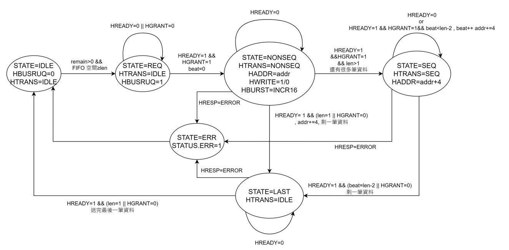
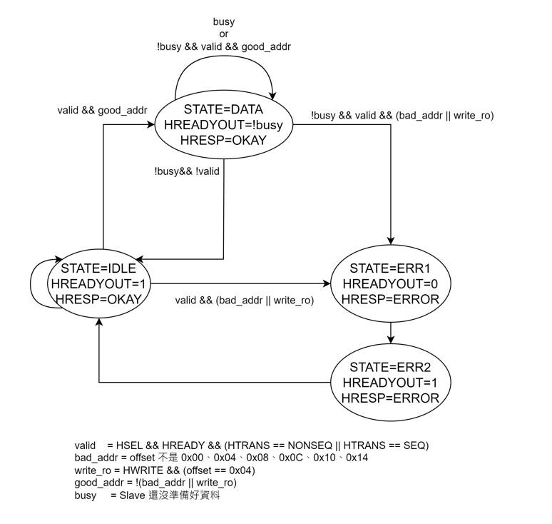
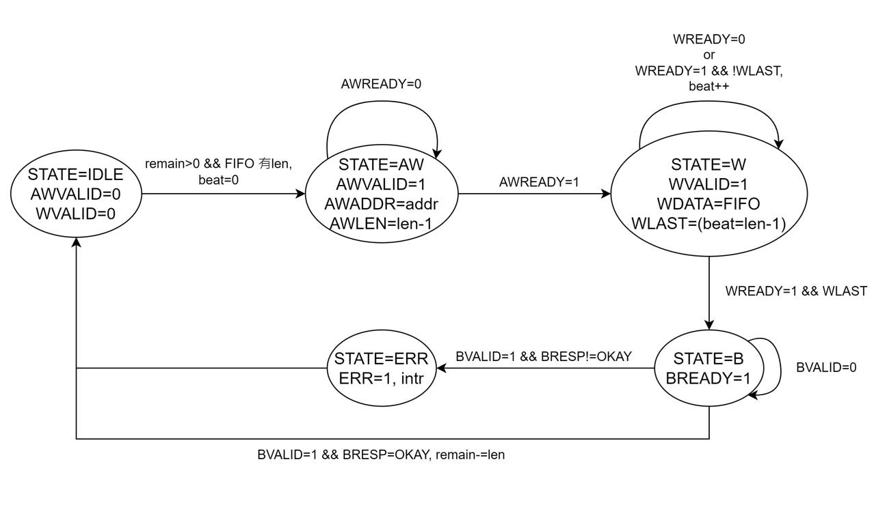
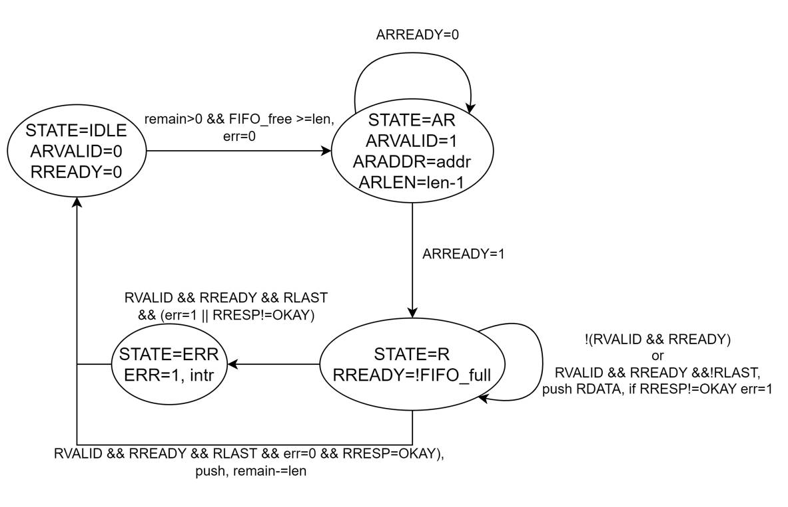
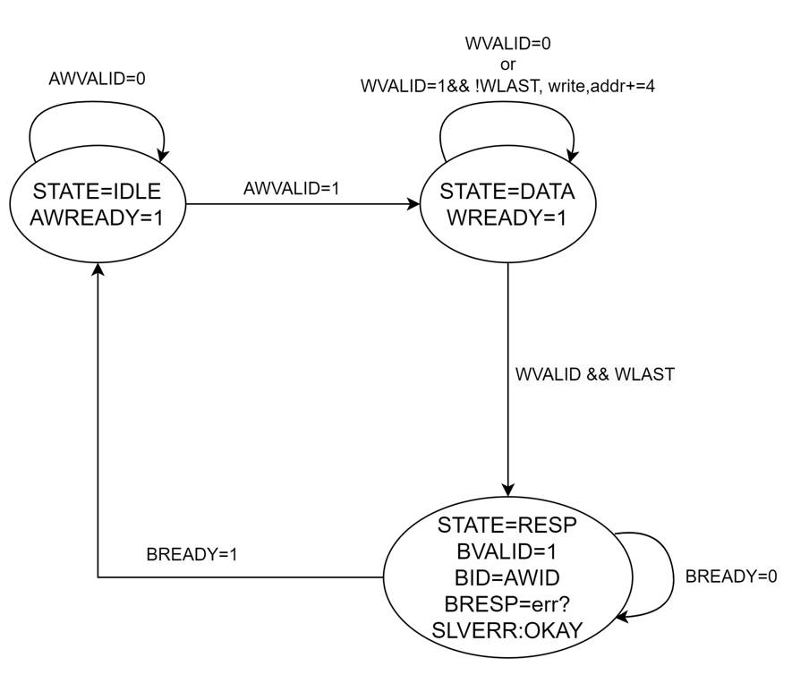
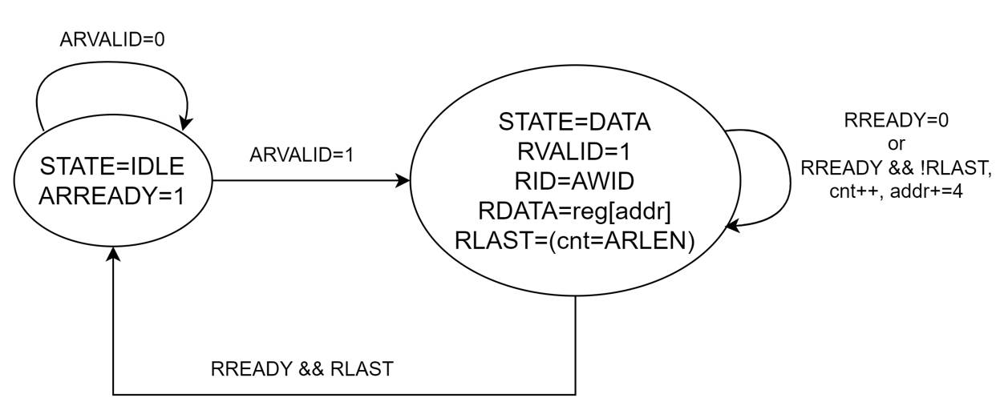

# HW1：AHB／AXI Wrapper FSM 與 Message Sequence Chart

SIP：UART（內含 Type 1 DMA，Master + Slave）

---

## 1. Wrapper 有限狀態機

### 1.1 AHB Master

---

### 1.2 AHB Slave

---

### 1.3 AXI Master（Write）

---

### 1.4 AXI Master（Read）

---

### 1.5 AXI Slave（Write）

---

### 1.6 AXI Slave（Read）

---

## 2. Message Sequence Chart

### 2.1 AHB

---

### 2.2 AXI

