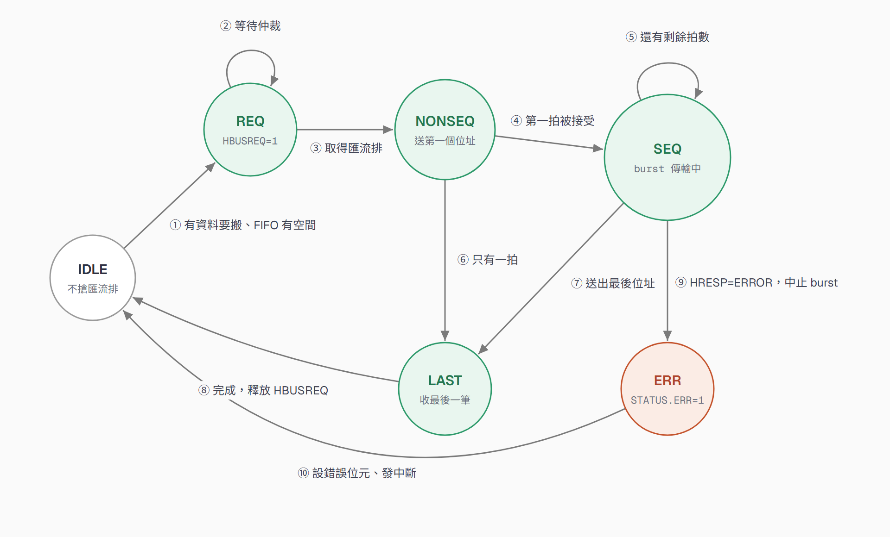
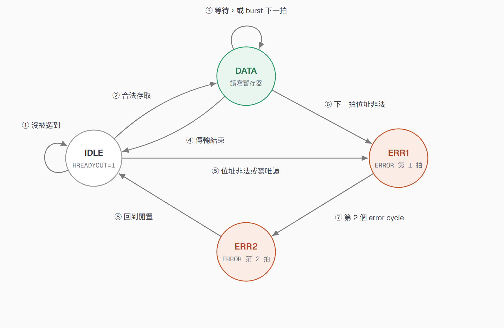
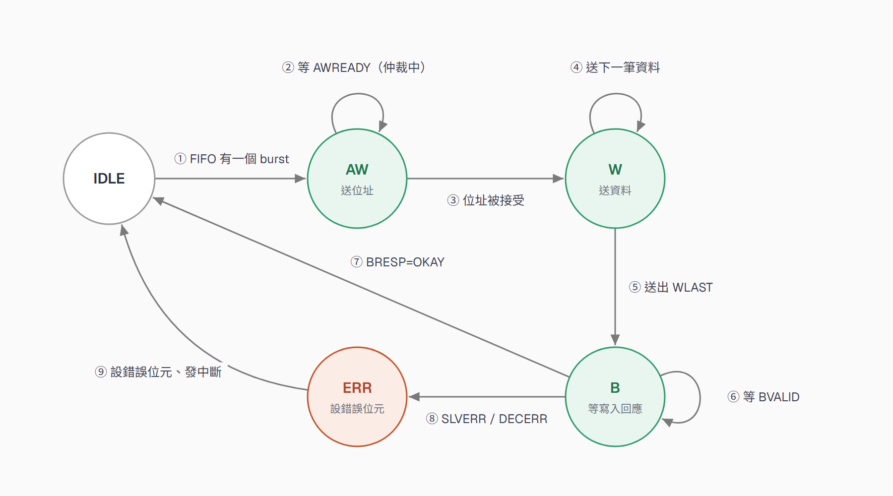
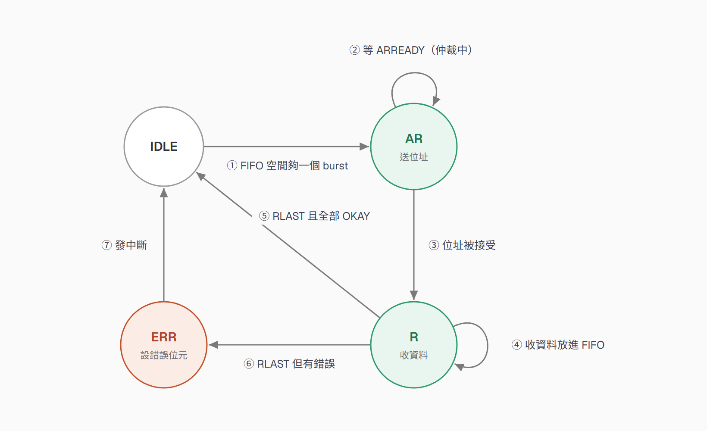
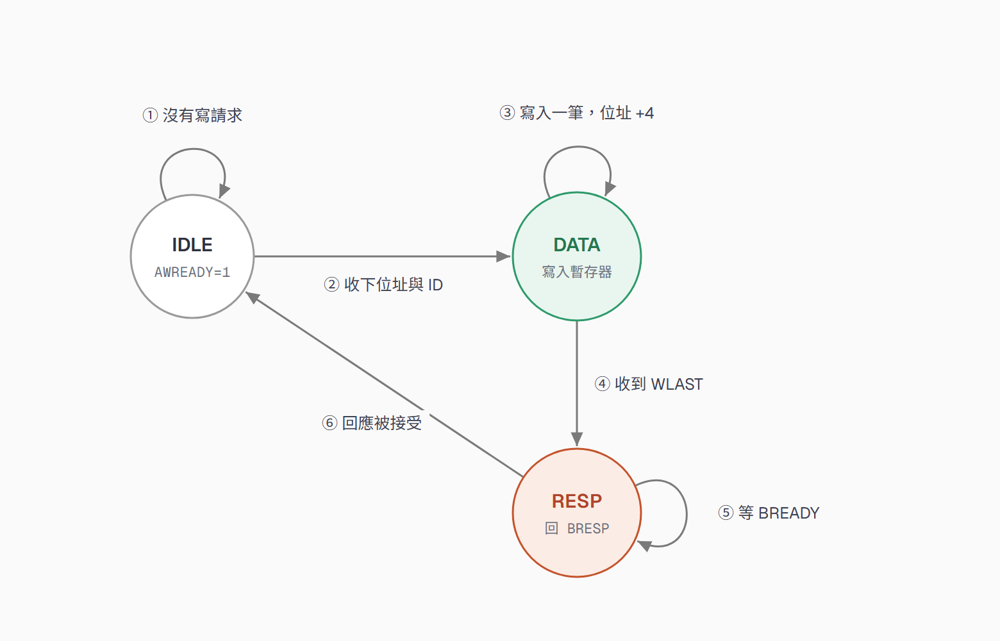
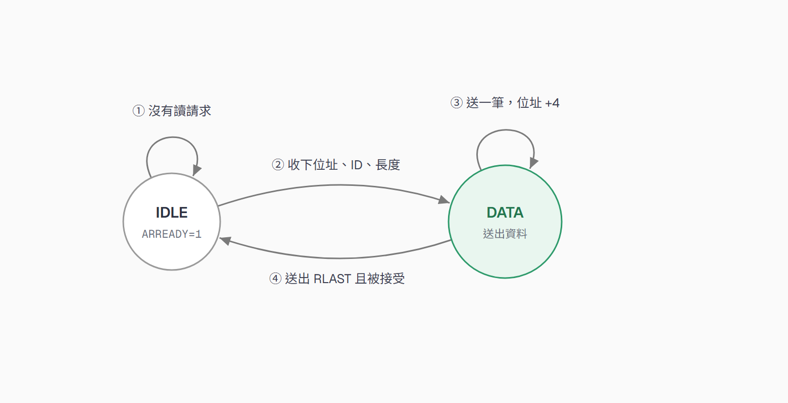
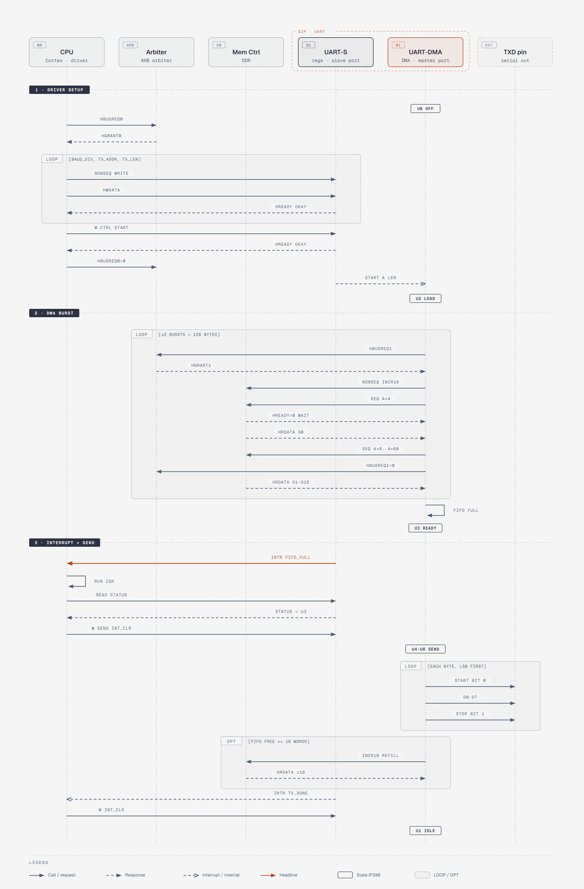
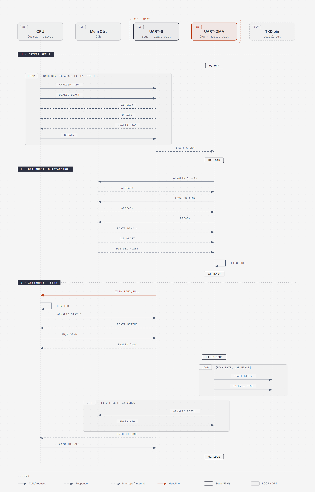

# HW1：AHB／AXI Wrapper FSM 與 Message Sequence Chart

SIP：UART（內含 Type 1 DMA，Master + Slave）

## 題目

1. 畫 AXI 和 AHB 的 Master 及 Slave wrapper 有限狀態機，要包含多 Masters、多 Slaves、Burst，從發出 request（仲裁）開始畫。→ [第 1 節](#1-wrapper-有限狀態機)
2. 畫 Message Sequence Chart，參與者 CPU(M)、Mem Ctrl(S)、SIP（M+S，內含 DMA），AHB 和 AXI 各一張。→ [第 2 節](#2-message-sequence-chart)
3. Bonus：把第 1 題寫成 RTL code 並模擬，程式碼要和自己畫的 FSM 一致。→ [第 3 節](#3-bonusrtl-與模擬)

## 檔案

| 路徑 | 內容 |
|---|---|
| `fsm/` | 六張 wrapper FSM（AHB Master／Slave、AXI Master／Slave 的讀與寫） |
| `msc/` | AHB、AXI 兩張 Message Sequence Chart |
| `bonus/` | Bonus：RTL、testbench、模擬波形，說明見 [bonus/README.md](bonus/README.md) |

---

## 1. Wrapper 有限狀態機

圖例：灰色是閒置、綠色是工作狀態、紅色是錯誤或回應狀態。箭頭上的編號是轉移順序，自迴圈表示停在原狀態等待。所有轉移都在下一個 clock edge 發生。

### 1.1 AHB Master（UART DMA）

| 狀態 | 行為 |
|---|---|
| IDLE | 不搶匯流排。DDR 還有資料要搬、TX FIFO 也空得出一個 burst 時，拉 HBUSREQ 進 REQ。 |
| REQ | 拉著 HBUSREQ 等 Arbiter。拿到 HGRANT，且上一個 master 的最後一筆已完成（HREADY=1），才進 NONSEQ。 |
| NONSEQ | 送出 burst 的第一個位址（INCR16）。這拍只有位址，還沒有資料。 |
| SEQ | burst 傳輸中：每拍送下一個位址，同時收上一個位址的資料（pipeline）。用 beat 計數，不必每拍一個狀態。送到倒數第二個位址時放掉 HBUSREQ。 |
| LAST | 位址都送完，只剩最後一筆資料。收完回 IDLE，等 FIFO 再空出空間。 |
| ERR | Slave 回 HRESP=ERROR，取消剩下的 beat，設 STATUS.ERR 並發中斷，回 IDLE。 |

- HREADY=0 時，每個狀態都停在原地並保持輸出，圖上沒有畫這些等待迴圈。
- LAST 收到 ERROR 也會進 ERR，圖上只畫 SEQ 這條。NONSEQ 那拍匯流排上的 data phase 還是上一筆傳輸的，所以不看 HRESP。

---

### 1.2 AHB Slave（UART 暫存器；Mem Ctrl 共用）

| 狀態 | 行為 |
|---|---|
| IDLE | HREADYOUT=1，等自己被選到。沒被選到、或 HTRANS 是 IDLE/BUSY，就留在這裡。 |
| DATA | Data phase，依 HWRITE 寫入或讀出暫存器。Burst 時每拍都會帶新位址，留在 DATA 繼續處理；Mem Ctrl 還沒準備好時拉 HREADYOUT=0 讓 master 等。 |
| ERR1 | 位址不存在或寫唯讀的 STATUS：回 HRESP=ERROR、HREADYOUT=0，讓 master 有一拍可以取消後面的傳輸。 |
| ERR2 | 第二拍 ERROR，HREADYOUT=1 結束這次傳輸，回 IDLE。 |

- 選擇訊號 HSEL 由 Decoder 產生，所以多 slave、多 master 時這個 FSM 都不用改。

---

### 1.3 AXI Master（Write）

| 狀態 | 行為 |
|---|---|
| IDLE | FIFO 累積到一個 burst 的資料就進 AW。 |
| AW | 拉 AWVALID 送位址與 burst 長度，等 AWREADY。READY 晚回來，代表 Interconnect 還在仲裁。 |
| W | 一拍送一筆資料，最後一筆帶 WLAST。 |
| B | 等 slave 的寫入回應：OKAY 回 IDLE，SLVERR/DECERR 進 ERR。 |
| ERR | 設錯誤位元、發中斷，回 IDLE。 |

- UART TX 用不到寫通道；UART RX 把收到的資料寫回 DDR 時才走這條。

---

### 1.4 AXI Master（Read）

| 狀態 | 行為 |
|---|---|
| IDLE | FIFO 空間夠放一個 burst 就進 AR。 |
| AR | 拉 ARVALID 送位址與 burst 長度，等 ARREADY（仲裁中）。 |
| R | 每收到一筆 RDATA 就放進 TX FIFO；FIFO 滿時拉低 RREADY 暫停。收到 RLAST 時，全部 OKAY 就回 IDLE，否則進 ERR。 |
| ERR | 設錯誤位元、發中斷，回 IDLE。 |

- UART TX 的 DMA 從 DDR 讀資料走的是這條。

---

### 1.5 AXI Slave（Write）

| 狀態 | 行為 |
|---|---|
| IDLE | AWREADY=1 等寫請求，收到後記下位址、長度和 AWID。 |
| DATA | WREADY=1，每收一筆就寫入暫存器、位址 +4，收到 WLAST 進 RESP。 |
| RESP | 拉 BVALID 回應，BID=AWID。寫到唯讀的 STATUS 回 SLVERR，否則回 OKAY。BREADY 來了就回 IDLE。 |

---

### 1.6 AXI Slave（Read）

| 狀態 | 行為 |
|---|---|
| IDLE | ARREADY=1 等讀請求，收到後記下位址、長度和 ARID。 |
| DATA | 拉 RVALID 送出暫存器資料（RID=ARID）。每被接受一筆，位址 +4；送到第 ARLEN+1 筆時帶 RLAST，被接受後回 IDLE。 |

- AXI 只給一次位址，slave 要自己算後面的位址、自己產生 RLAST，這點和 AHB 不同。

---

## 2. Message Sequence Chart

參與者：CPU（Master）、Mem Ctrl（Slave，DDR）、UART（SIP，內含 DMA：UART-S 是 Slave port，UART-DMA 是 Master port）。
流程：CPU 設定 DMA → DMA 用 burst 把資料讀進 FIFO → FIFO 滿了發中斷 → CPU 在 ISR 裡叫 UART 送出。圖上方框是 UART 核心的狀態。

### 2.1 AHB

| 段 | 流程 | 說明 |
|---|---|---|
| 1 | 驅動程式設定 | CPU 送 HBUSREQ0 拿到 HGRANT0，用 single transfer 寫 BAUD_DIV、TX_ADDR、TX_LEN，最後寫 CTRL.START；UART 內部把位址和長度交給 DMA |
| 2 | DMA burst | DMA 送 HBUSREQ1 拿到匯流排，用 INCR16 讀 DDR：先 NONSEQ 再 SEQ，每拍送下一個位址、同時收上一筆資料；HREADY=0 時等待。做兩次填滿 128 byte FIFO |
| 3 | 中斷與送出 | FIFO 滿了發 INTR，CPU 執行 ISR：讀 STATUS、寫 SEND 和 INT_CLR。UART 從 TXD 依序送 start bit、8 個 data bit、stop bit；FIFO 有空間時 DMA 再 burst 補資料，全部送完發 TX_DONE 中斷 |

---

### 2.2 AXI

| 段 | 流程 | 說明 |
|---|---|---|
| 1 | 驅動程式設定 | 沒有 HBUSREQ／HGRANT，CPU 直接拉 VALID。每個暫存器走 AW、W、B 三個通道，AW 和 W 可以同時送，等 BVALID 回 OKAY 才算寫完 |
| 2 | DMA burst | DMA 連送兩個 AR（ARLEN=15），第一個 burst 的資料還沒回來就送第二個位址（outstanding）。資料走 R 通道，用 RLAST 分辨兩個 burst |
| 3 | 中斷與送出 | 和 AHB 版相同；讀 STATUS 走 AR／R，寫 SEND 走 AW／W／B |

**AHB 和 AXI 的差別**：AHB 要先向 Arbiter 請求、位址一定比資料早一拍、一次只能有一個 burst；AXI 拉 VALID 就是請求、位址和資料分通道、可以同時有多個 burst 在等資料。

---

## 3. Bonus：RTL 與模擬

把第 1 節的六張 FSM 寫成 Verilog，用 Icarus Verilog 模擬，再把模擬波形拿去和 AMBA AHB（IHI 0033）、AXI（IHI 0022）規格書上的波形對照。

**怎麼確定 RTL 和 FSM 一致**：RTL 的狀態名稱和圖上一樣，每個轉移的註解都標了圖上箭頭的編號（①②③…）。例如 `ahb_master.v` 的 `REQ: if (HGRANT && HREADY) state <= NONSEQ; // ③` 就是圖 1.1 的箭頭 ③。

| FSM | RTL |
|---|---|
| 1.1 AHB Master | `bonus/rtl/ahb_master.v` |
| 1.2 AHB Slave | `bonus/rtl/ahb_slave.v` |
| 1.3 AXI Master Write | `bonus/rtl/axi_master_wr.v` |
| 1.4 AXI Master Read | `bonus/rtl/axi_master_rd.v` |
| 1.5、1.6 AXI Slave Write／Read | `bonus/rtl/axi_slave.v` |

**模擬結果**：AHB testbench（2 masters + Arbiter + Decoder + 2 slaves）9 項檢查、AXI testbench 15 項檢查全部通過，涵蓋 burst、wait state、仲裁等待、FIFO 滿時 RREADY 暫停，以及 ERROR／SLVERR 回應。

下圖是 DMA 搶到匯流排後做 INCR16 讀取：位址比資料早一拍（pipeline），Mem Ctrl 每筆插一拍 wait state（HREADY=0）。

其他波形（AHB 兩拍 ERROR、AXI 讀、AXI 寫）和執行方式在 [bonus/README.md](bonus/README.md)。
