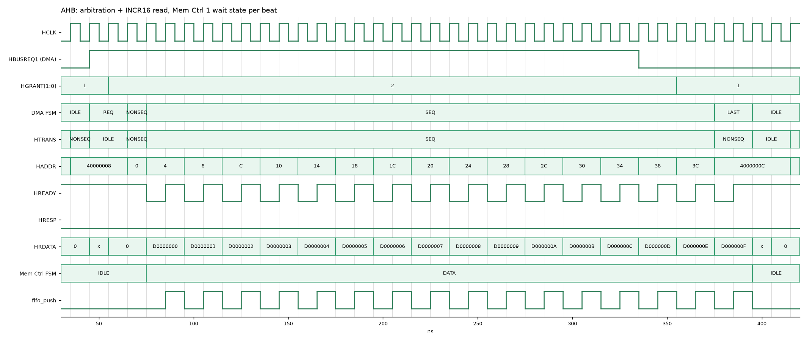
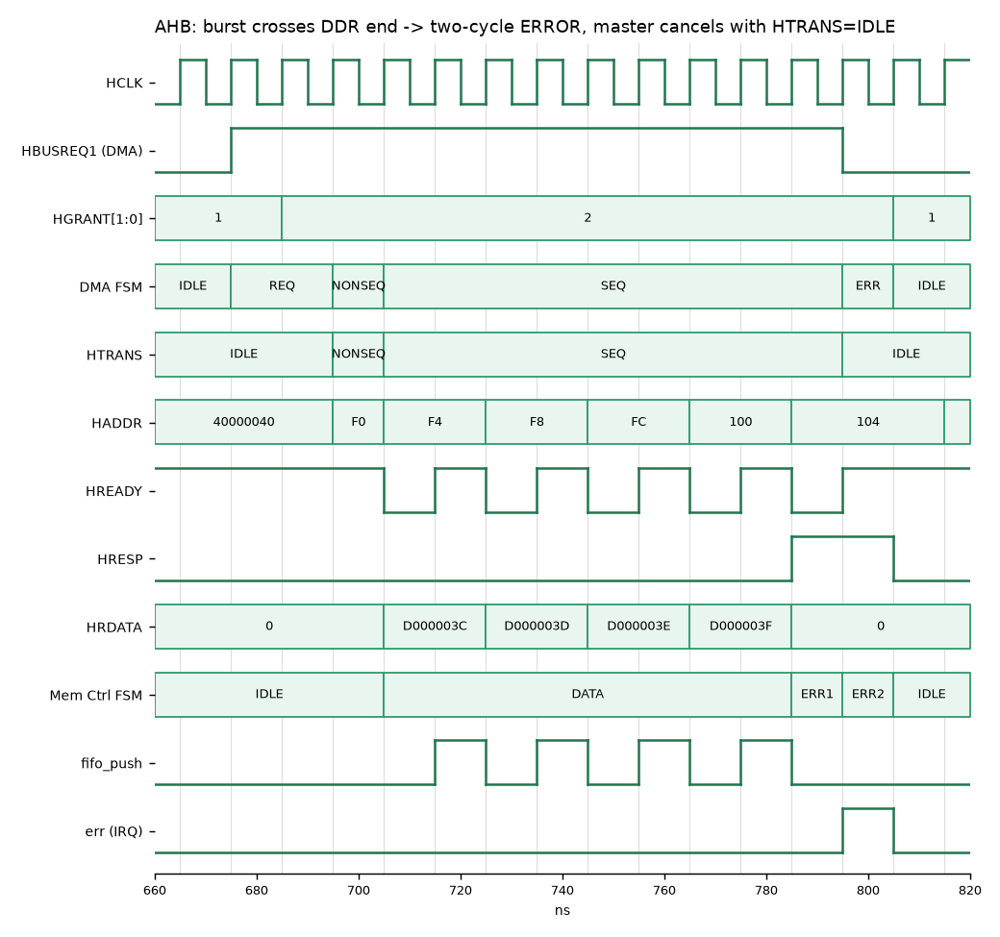
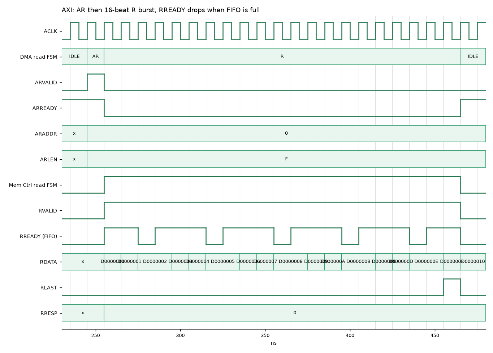
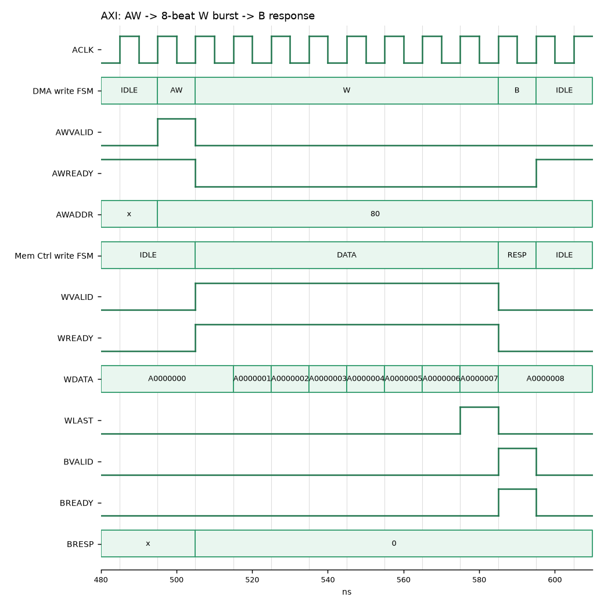

# HW1 Bonus：Wrapper FSM 的 RTL 與模擬

用 Icarus Verilog 模擬，波形對照 AMBA AHB（IHI 0033）和 AXI（IHI 0022）規格書。
**狀態名稱、轉移條件和  1.1～1.6 的圖一一對應**，程式碼註解裡的 ①②③ 就是圖上箭頭的編號。

## 檔案

| 檔案 | 對應 FSM | 狀態 |
|---|---|---|
| `rtl/ahb_master.v` | 1.1 AHB Master（UART DMA） | IDLE → REQ → NONSEQ → SEQ → LAST，ERR |
| `rtl/ahb_slave.v` | 1.2 AHB Slave（UART 暫存器；Mem Ctrl 共用） | IDLE → DATA，ERR1 → ERR2 |
| `rtl/axi_master_wr.v` | 1.3 AXI Master Write | IDLE → AW → W → B，ERR |
| `rtl/axi_master_rd.v` | 1.4 AXI Master Read | IDLE → AR → R，ERR |
| `rtl/axi_slave.v` | 1.5、1.6 AXI Slave Write／Read（共用暫存器） | 寫：IDLE → DATA → RESP；讀：IDLE → DATA |
| `tb/tb_ahb.v` | AHB 系統：CPU + DMA 兩個 master、Arbiter、Decoder、UART + Mem Ctrl 兩個 slave | |
| `tb/tb_axi.v` | AXI 系統：CPU → UART，DMA 讀／寫 → Mem Ctrl | |
| `run.sh` | 編譯並跑兩個 testbench | |
| `wave.py` | 把 VCD 畫成 `wave/*.png` | |

暫存器位址照第 1 題：CTRL 0x00、STATUS 0x04（唯讀）、BAUD_DIV 0x08、TX_ADDR 0x0C、TX_LEN 0x10、INT_CLR 0x14。

## 測試項目

**AHB**

| 測試 | 檢查 |
|---|---|
| CPU 寫 BAUD_DIV 再讀回 | 讀回 434，HRESP=OKAY |
| DMA INCR16 讀 DDR，同時 CPU 也在用匯流排 | DMA 在 REQ 等仲裁；收到 16 筆，內容等於 DDR[0..15] |
| 寫唯讀 STATUS、寫不存在的位址 | HRESP=ERROR（兩拍） |
| DMA SINGLE（只有一拍） | 走 NONSEQ → LAST，讀到 DDR[8] |
| DMA burst 超出 DDR 範圍 | 收 4 筆後 slave 回 ERROR，DMA 進 ERR、中止剩下的 beat，回 IDLE |

**AXI**

| 測試 | 檢查 |
|---|---|
| CPU 寫 4 個暫存器（AW、W 同時送） | BRESP=OKAY |
| CPU 寫唯讀 STATUS | BRESP=SLVERR，STATUS 沒被改 |
| CPU 一個 burst 讀 5 個暫存器（ARLEN=4） | 5 筆資料正確，RLAST 只在最後一筆 |
| DMA 讀 16 筆，FIFO 每 4 拍滿一次 | RREADY 拉低時暫停，資料仍然正確 |
| DMA 寫 8 筆到 DDR 0x80 | DDR 內容等於 RX 資料 |
| DMA 讀、寫超出 DDR 範圍 | RRESP／BRESP=SLVERR，進 ERR 再回 IDLE |

## 波形

### AHB：仲裁 + INCR16（Mem Ctrl 每拍 1 個 wait state）

- DMA 拉 HBUSREQ1 後在 **REQ** 等兩拍，HGRANT 換成 DMA 才進 NONSEQ（圖 ① ② ③）。
- 位址和資料差一拍（pipeline）：HADDR=0x4 那拍，HRDATA 才是 0x0 的資料。對照 IHI 0033 Transfers 章節的 burst 範例圖。
- HREADY=0 時 master 不換位址，這就是 wait state（IHI 0033 的 wait state 範例圖）。
- 送到倒數第二個位址 0x38 時放掉 HBUSREQ1。下一個 owner CPU 的 NONSEQ 和 DMA 的最後一個 data phase 重疊，等 HREADY=1 才換手（IHI 0033 的 bus handover 圖）。

### AHB：兩拍 ERROR

- 位址 0x100 超出 DDR，Mem Ctrl 進 **ERR1**：HRESP=1、HREADY=0；下一拍 **ERR2**：HRESP=1、HREADY=1（IHI 0033 Slave Response 章節的 ERROR response 圖）。
- DMA 在 ERR1 那拍看到 HRESP=1 就進 **ERR**，下一拍把 HTRANS 改成 IDLE，取消剩下的 beat，同時發 err 中斷。

### AXI：讀 burst，FIFO 滿時暫停

- ARVALID 和 ARREADY 同時為 1 的那拍位址被接受（AR → R）。
- RVALID=1、RREADY=0 時資料不動，等 FIFO 有空間。對照 IHI 0022 的 read burst 圖。
- RLAST 由 slave 自己數 ARLEN 產生，只在第 16 筆。

### AXI：寫 burst

- AW 被接受後送 8 筆 W，最後一筆帶 WLAST；slave 進 **RESP** 拉 BVALID，BREADY=1 那拍回應被接受，兩邊都回 IDLE。

