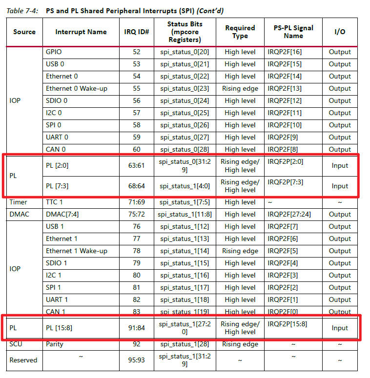
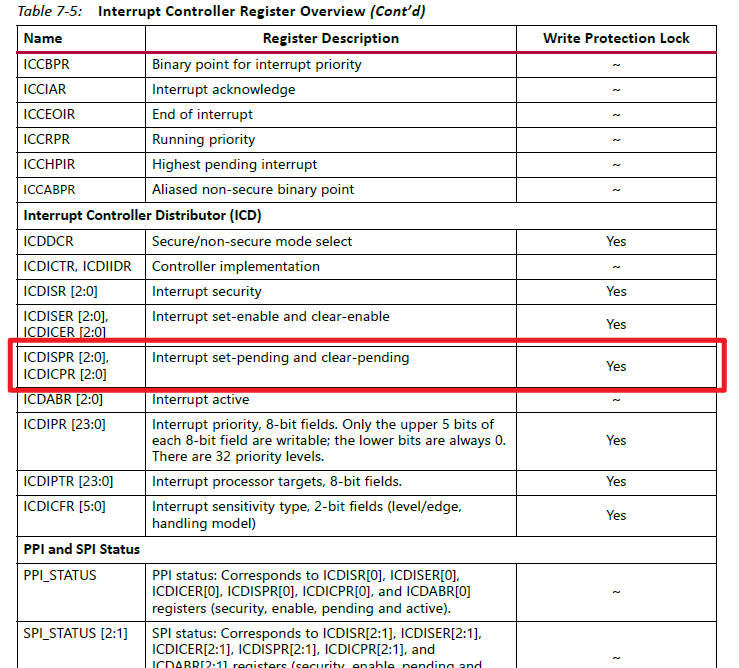
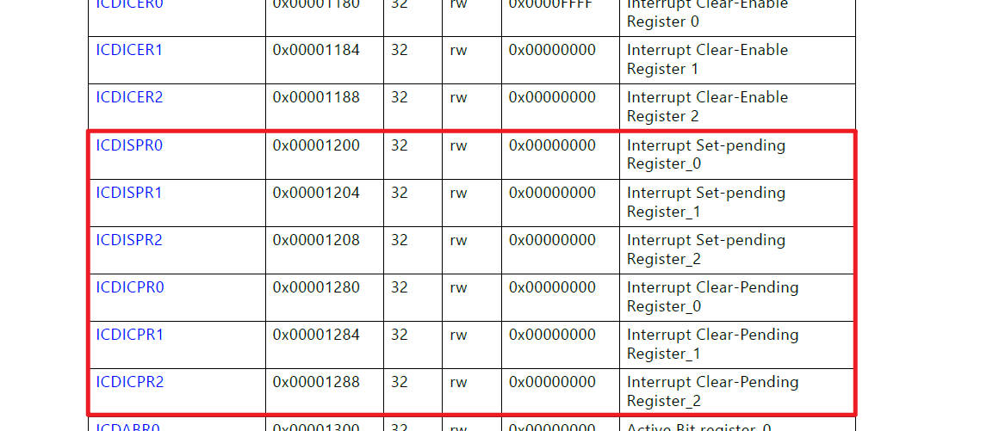
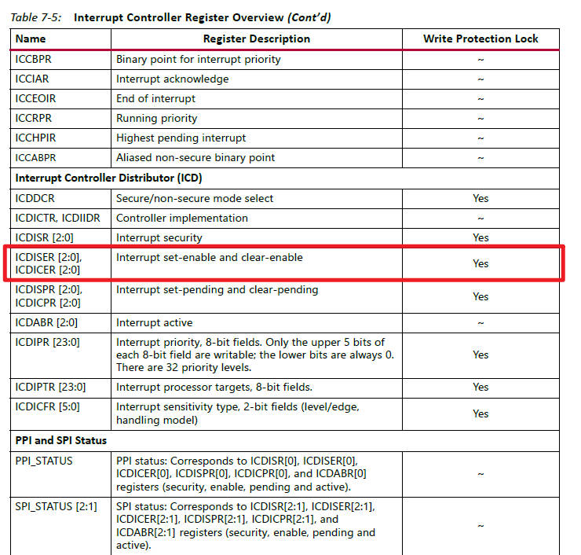
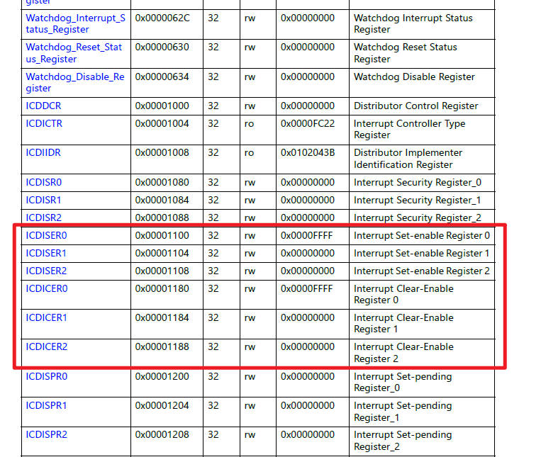
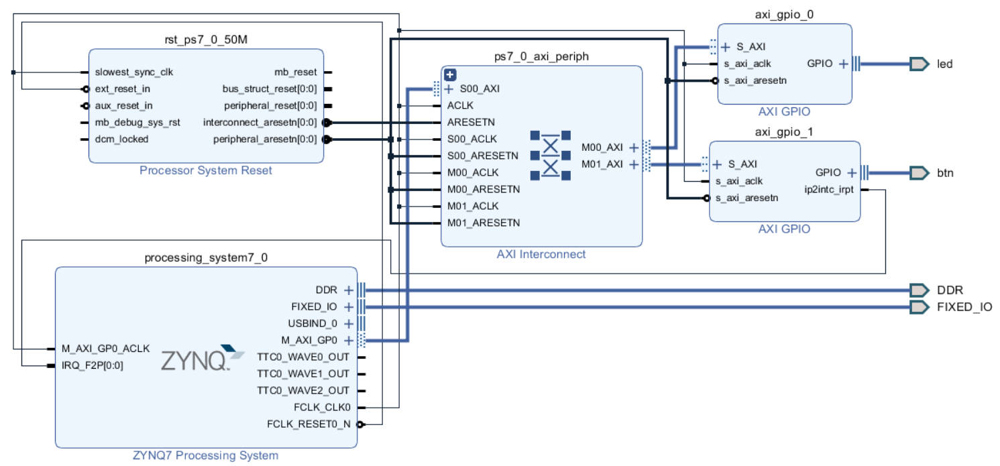

# HW2：Zynq-7020 中斷與 LED 驅動

| 項目 | 內容 |
|---|---|
| 開發板 | E-Elements EGO-XZ7（Zynq-7020，XC7Z020-1CLG484，雙核 Cortex-A9） |
| 工具 | Vivado 2018.2、Xilinx SDK 2018.2 |
| 題目 | 1. 找 Zynq-7020 的手冊（User Guide、Programming Guide）<br>2. 找 UG 裡與中斷相關、有位址的暫存器<br>3. ① 點亮 LED（C → FPGA → LED）② 按按鈕後 LED 有變化：寫 Driver 和 ISR |

```
HW2/
├── README.md        本報告
├── images/          報告用圖（block design、UG585 截圖）
├── vivado/pins.xdc  EGO-XZ7 的 LED、按鈕腳位
└── sdk/main.c       Driver + ISR（跑馬燈 + 按鈕中斷）
```

---

## 1. 手冊中與 BSP、ISR 相關的章節

| 類型 | 文件 |
|---|---|
| User Guide | **UG585** Zynq-7000 SoC Technical Reference Manual（v1.14） |
| Programming Guide | **UG821** Zynq-7000 SoC Software Developers Guide（v12.0） |

### 1.1 BSP 相關章節（UG821）

| 章節 | 頁 | 內容 |
|---|---|---|
| Ch.2 Software Application Development Flows → Software Tools Overview | 10～12 | Vivado 把 PS 設定和 PL 資訊匯出成硬體描述檔，SDK 據此建立並設定 BSP |
| Ch.2 → **Bare-Metal Device Driver Architecture** | 14～17 | standalone 驅動的架構：Layer 2（RTOS Adapter）、Layer 1（Device Driver API），以及 Layer 1 內含的 Direct Hardware Interface（暫存器位址常數和讀寫巨集） |
| Ch.2 → **Bare-Metal Application Development → Creating Bare-Metal BSP** | 17～19 | 匯入硬體平台 → 建立 BSP → 建立應用程式 → 編譯 → 燒錄執行。BSP 的驅動程式和函式庫會依硬體平台參數化 |
| Ch.4 Linux → Linux BSP Contents | 53 | Linux 環境下的 BSP（本作業用 standalone，僅參考） |

**本作業的 BSP**：SDK 讀取 Vivado 匯出的 `.hdf`，產生 standalone BSP：

- `xparameters.h`：每個 IP 的位址和中斷編號。例如 `XPAR_AXI_GPIO_0_BASEADDR = 0x41200000`、`XPAR_FABRIC_AXI_GPIO_1_IP2INTC_IRPT_INTR = 61`。
- `xil_io.h`：`Xil_In32`／`Xil_Out32`，相當於 UG821 所說的 Direct Hardware Interface。本作業的驅動程式直接用它讀寫 GIC 和 GPIO 的暫存器。
- `xil_exception.h`：`Xil_ExceptionRegisterHandler` 把 ISR 掛到 IRQ 向量。
- 開機程式、例外向量表、`ps7_init`（時脈和 DDR 初始化）。

### 1.2 ISR 相關章節（UG585）

| 章節 | 頁 | 內容 |
|---|---|---|
| **Ch.7 Interrupts** → Environment、Generic Interrupt Controller (GIC) | 231～234 | 中斷系統架構：SGI、PPI、SPI 三種中斷，以及 GIC 的方塊圖 |
| Ch.7 → Functional Description（SGI、PPI、SPI） | 235～238 | 每個中斷來源的 IRQ ID（Table 7-2、7-3、7-4） |
| Ch.7 → Interrupt Sensitivity, Targeting and Handling | 238～239 | 觸發方式（level／edge）、送給哪顆 CPU |
| Ch.7 → Register Overview | 241～242 | GIC 暫存器總覽（Table 7-5） |
| Ch.7 → **Programming Model → Interrupt Prioritization、Interrupt Handling** | 243～244 | GIC 怎麼選出最高優先權的 pending 中斷送給 CPU，以及 ISR 該怎麼處理 |
| Appendix A → Application Processing Unit (mpcore) | 1483～ | 每個 GIC 暫存器的位址和欄位定義 |

UG585 p.244 說明 ISR 的處理方式：*the software ISR determines the cause by checking the GIC registers first and then polling the I/O Peripheral interrupt status registers.* 也就是 ISR 要先讀 GIC 的暫存器（ICCIAR）確認是哪個中斷，再去讀周邊自己的中斷狀態暫存器。本作業的 `btn_isr()` 就是照這個順序：先讀 ICCIAR 確認 ID 61，再讀 AXI GPIO 的狀態並清除中斷。

---

## 2. UG585 中與中斷相關的暫存器

### 2.1 中斷的路徑

```
按鈕 → axi_gpio_1 (ip2intc_irpt) → IRQ_F2P[0] → GIC Distributor → GIC CPU Interface → CPU (IRQ)
                                                                                         │
  CPU 跳到向量表的 IRQ 入口 → btn_isr()：讀 ICCIAR 拿到 ID 61 → 處理 → 清中斷來源 → 寫 ICCEOIR
```

Zynq 的中斷控制器是 ARM 的 **GIC（Generic Interrupt Controller）**，分成兩部分：

- **Distributor（ICD，基底 0xF8F0_1000）**：決定每個中斷要不要開、優先權多高、送給哪顆 CPU、用 level 還是 edge 觸發。
- **CPU Interface（ICC，基底 0xF8F0_0100）**：把中斷交給 CPU。CPU 從這裡讀中斷編號，處理完再回報。

### 2.2 IRQ #（port）：中斷編號



*UG585 Table 7-4（p.238）PS and PL Shared Peripheral Interrupts*

FPGA（PL）送給 CPU 的中斷走 **IRQ_F2P[15:0]** 這 16 條線，編號固定如下：

| PS-PL 訊號 | IRQ ID |
|---|---|
| IRQF2P[2:0] | 63 : 61 |
| IRQF2P[7:3] | 68 : 64 |
| IRQF2P[15:8] | 91 : 84 |

本作業的按鈕中斷 `ip2intc_irpt` 直接接到 ZYNQ 的 `IRQ_F2P[0:0]`，所以是 **IRQ_F2P[0]，ID = 61**。

驗證方式：
- SDK 產生的 `xparameters.h` 裡，`XPAR_FABRIC_AXI_GPIO_1_IP2INTC_IRPT_INTR` 的值也是 61，跟查表的結果一致。
- UG585 p.237 寫明：ID 61～68、84～91 的觸發方式 boot ROM 不會設定，**驅動程式要自己寫 ICDICFR**。另外 level 觸發的中斷，來源端要能在 ISR 裡被清除。

### 2.3 pending register（port status）：中斷的等待狀態



*UG585 Table 7-5（p.242）*



*UG585 Appendix A mpcore 暫存器表（p.1485）*

中斷發生、但 CPU 還沒處理時，會停在 **pending** 狀態。

| 暫存器 | 位址 | 功能 |
|---|---|---|
| ICDISPR0 / 1 / 2 | 0xF8F0_1200 / 1204 / 1208 | 讀：哪些中斷在 pending。寫 1：用軟體觸發該中斷 |
| ICDICPR0 / 1 / 2 | 0xF8F0_1280 / 1284 / 1288 | 寫 1：清除 pending |

ID 61 對應 **ICDISPR1／ICDICPR1 的 bit 29**。

本作業在初始化、打開中斷之前，先寫 **ICDICPR1 bit 29** 清掉 ID 61 可能殘留的 pending，避免一打開就收到舊的中斷。除錯時，可以對 ICDISPR1 bit 29 寫 1，不用按按鈕也能讓 CPU 進 ISR，用來確認 GIC 和 ISR 這一段有沒有問題。

### 2.4 mask register（port enable）：中斷的開關



*UG585 Table 7-5（p.242）Interrupt Controller Register Overview*



*UG585 Appendix A mpcore 暫存器表（p.1485），基底 0xF8F0_0000*

GIC 沒有一般意義上的 mask 暫存器，而是用一對暫存器代替：**ICDISER（Set-Enable）寫 1 打開，ICDICER（Clear-Enable）寫 1 關閉**。寫 0 沒有作用，所以不會動到其他中斷。每個中斷占 1 bit，3 個暫存器共 96 bit，對應 ID 0～95。

| 暫存器 | 位址 | 功能 |
|---|---|---|
| ICDISER0 / 1 / 2 | 0xF8F0_1100 / 1104 / 1108 | 寫 1：開啟中斷 |
| ICDICER0 / 1 / 2 | 0xF8F0_1180 / 1184 / 1188 | 寫 1：關閉中斷 |

**ID 61 要寫哪裡**：61 ÷ 32 = 1 餘 29，所以是 **ICDISER1（0xF8F0_1104）的 bit 29**。本作業初始化時寫入這個 bit，打開 ID 61。

### 2.5 本作業用到的全部暫存器

**GIC（UG585 Appendix A，mpcore，p.1484～1485、1496～1561）**

| 暫存器 | 位址 | 寫入值 | 用途 |
|---|---|---|---|
| ICCICR | 0xF8F0_0100 | 0x07 | 開啟 CPU Interface |
| ICCPMR | 0xF8F0_0104 | 0xF0 | 優先權門檻，數值比它小的中斷才會送給 CPU |
| **ICCIAR** | 0xF8F0_010C | 讀 | ISR 開頭讀，bit[9:0] 是中斷 ID。讀取同時代表 CPU 收下了這個中斷 |
| **ICCEOIR** | 0xF8F0_0110 | 寫回 ICCIAR 的值 | ISR 結尾寫，告訴 GIC 處理完了 |
| ICDDCR | 0xF8F0_1000 | 1 | 開啟 Distributor |
| **ICDICPR1** | 0xF8F0_1284 | bit 29 = 1 | pending register：清除 ID 61 殘留的 pending |
| **ICDISER1** | 0xF8F0_1104 | bit 29 = 1 | mask register：開啟 ID 61 |
| ICDIPR | 0xF8F0_1400 + 61 | 0xA0 | ID 61 的優先權（每個 ID 1 byte） |
| ICDIPTR | 0xF8F0_1800 + 61 | 0x01 | ID 61 送給 CPU0（每個 ID 1 byte） |
| **ICDICFR3** | 0xF8F0_1C0C | bit[27:26] = 01 | ID 61 設為 high level 觸發（61 ÷ 16 = 3 餘 13，13 × 2 = bit 26） |

**AXI GPIO（PG144），axi_gpio_1 基底 0x4121_0000**

| 暫存器 | 偏移 | 用途 |
|---|---|---|
| GPIO_DATA | 0x000 | 按鈕目前的狀態 |
| GIER | 0x11C | bit 31：中斷總開關 |
| IPISR | 0x120 | 中斷狀態，寫 1 清除 |
| IPIER | 0x128 | bit 0：開啟 Channel 1 中斷 |

---

## 3. 實作

### 3.1 硬體架構



| 元件 | 設定 | 用途 |
|---|---|---|
| processing_system7_0 | 打開 Fabric Interrupts → IRQ_F2P | CPU、DDR，以及 PL 中斷的入口 |
| axi_gpio_0 | All Outputs，寬度 8，外接 port 名稱 `led` | 8 顆 LED |
| axi_gpio_1 | All Inputs，寬度 1，Enable Interrupt，外接 port 名稱 `btn` | 按鈕，`ip2intc_irpt` 接到 `IRQ_F2P[0:0]` |
| ps7_0_axi_periph | AXI Interconnect | CPU（M_AXI_GP0）連到兩個 GPIO |
| rst_ps7_0_50M | Processor System Reset | FCLK_CLK0 = 50 MHz 的 reset |

**Address Editor**

| Cell | Offset Address | Range |
|---|---|---|
| axi_gpio_0（LED） | 0x4120_0000 | 64K |
| axi_gpio_1（按鈕） | 0x4121_0000 | 64K |

**腳位（[vivado/pins.xdc](vivado/pins.xdc)）**

| 訊號 | 腳位 | IO 標準 |
|---|---|---|
| LED0～LED7（led_tri_o[0:7]） | T22、T21、U22、U21、V22、W22、U19、U14 | LVCMOS33 |
| 按鈕（btn_tri_i[0]） | P16 | LVCMOS25 |


### 3.2 驅動程式與 ISR（SDK）

程式：[sdk/main.c](sdk/main.c)

**LED 的客製化反應**：8 顆 LED 跑馬燈，每 0.2 秒移一格。按一下按鈕，跑馬燈停住；再按一下，繼續跑。

**按鈕訊號的路徑**：板子上的 push button → PL 的 `axi_gpio_1`（FPGA）→ `ip2intc_irpt` → `IRQ_F2P[0]` → GIC（ID 61）→ CPU → `btn_isr()`。

**初始化**（main），由外往內分三層設定：

| 層 | 做什麼 | 寫的暫存器 |
|---|---|---|
| 中斷來源（AXI GPIO） | 開 Channel 1 中斷、開總開關 | IPIER、GIER |
| 中斷控制器（GIC） | ID 61 的優先權、目標 CPU、觸發方式，清除殘留 pending，打開 mask，開 Distributor 和 CPU Interface | ICDIPR、ICDIPTR、ICDICFR3、**ICDICPR1**、**ICDISER1**、ICDDCR、ICCPMR、ICCICR |
| CPU | 把 `btn_isr` 掛到 IRQ 向量，清 CPSR 的 I bit | `Xil_ExceptionRegisterHandler`、`Xil_ExceptionEnable` |

**中斷發生時的流程**：

```
main 正在 while(1) 跑跑馬燈
        │  按下按鈕
        ▼
硬體觸發 IRQ，CPU 暫停 main，跳到 btn_isr()
   1. 讀 ICCIAR → 得到 ID 61
   2. 讀 GPIO_DATA，確認是「按下」，而且距離上次超過 200 ms → paused 反轉
   3. 寫 IPISR → 清除 AXI GPIO 的中斷（level 觸發，不清會一直進來）
   4. 寫 ICCEOIR → 告訴 GIC 處理完了
        │
        ▼
回到 main 中斷前的位置繼續跑；paused = 1 時 LED 不再移動
```


## 參考資料

- UG585 Zynq-7000 SoC Technical Reference Manual v1.14：Ch.7 Interrupts（p.231～244）、Appendix A mpcore（p.1483～）
- UG821 Zynq-7000 SoC Software Developers Guide v12.0：Ch.2 Software Application Development Flows（p.9～26）
- PG144 AXI GPIO LogiCORE IP Product Guide
- Xilinx SDK 2018.2 原始碼：`xscugic_hw.h`、`xparameters_ps.h`、`xgpio_l.h`（用來交叉核對暫存器位址）
